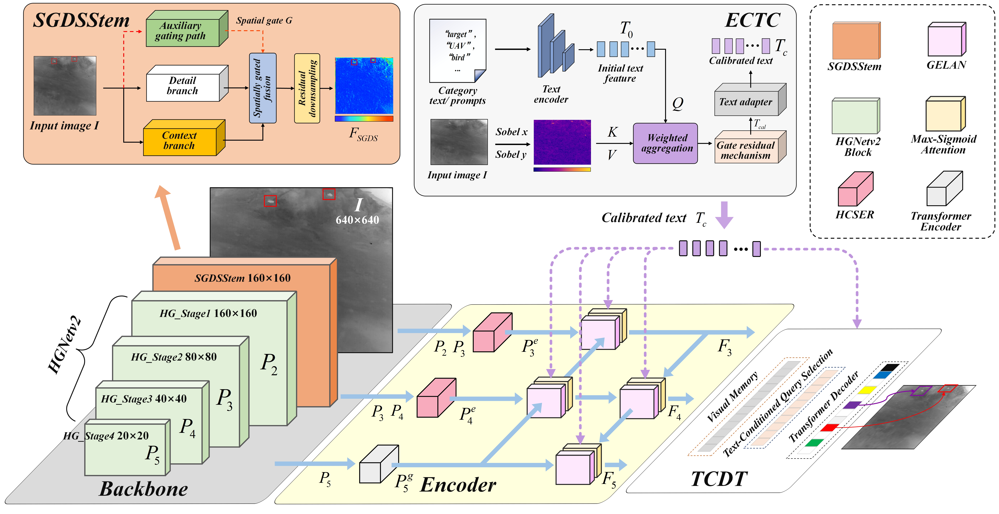

# EIGVLFormer

Edge Information Guides Vision–Language Collaboration for Infrared Small Target Detection

## Overall Architecture




## Dependencies

Install the required dependencies:

```bash
pip install -r requirements.txt
```

The `requirements.txt` file contains:

```text
PyYAML
tensorboard
swanlab
scipy
calflops
thop
tidecv
einops
prettytable
PyWavelets
easydict
dill
faster-coco-eval>=1.6.5
nvidia-ml-py>=12.0.0
pycocotools==2.0.11
pytorch_wavelets==1.3.0
timm==1.0.27
grad-cam==1.5.5
transformers==5.3.0
sentencepiece==0.2.1
setuptools==80.10.2
gradio==6.9.0
```


